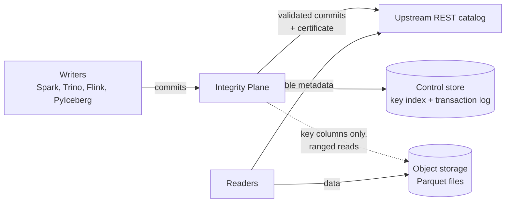
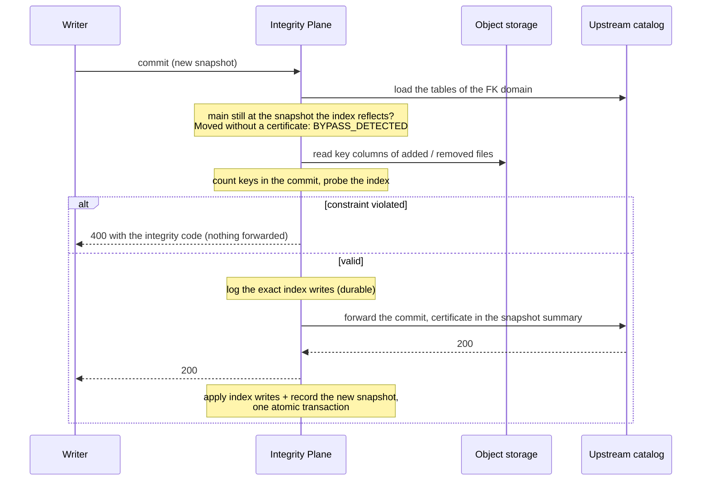

# Open Integrity Plane

Commit-time PRIMARY KEY / UNIQUE / NOT NULL / FOREIGN KEY enforcement for Apache Iceberg tables,
independent of the writing engine, with verifiable integrity certificates.

Iceberg enforces no keys: two jobs that each MERGE from the same snapshot can both insert key 42,
and nothing checks references between tables. The Plane sits between writers and the REST catalog
and refuses such commits before they reach it.

A commit never rescans the table: it is checked against the Plane's own key index ([How it
works](#how-it-works)).


<sub>`demo/demo.py` against `deploy/docker-compose.yml`, recorded with `demo/record.sh`.</sub>

> **Status: pre-alpha (0.1.0), not production-ready.** Do not use this for data you care about.
> Only what is listed below is implemented, and only within the limits stated in the linked docs.

## Quickstart

Needs Docker and Python 3.10+; nothing to build. Starts S3 storage, the Iceberg reference REST
catalog and the Plane, then runs the demo above:

```sh
git clone https://github.com/JeonDaehong/integrity-plane && cd integrity-plane
docker compose -f deploy/docker-compose.yml up -d
pip install "pyiceberg[pyarrow]==0.12.0"
python demo/demo.py "docker exec integrity-plane integrity"
```

Point any Iceberg client at `http://127.0.0.1:8181` as its REST catalog (S3 endpoint
`http://127.0.0.1:9000`, path-style, credentials `admin`/`password`) to try your own commits.
`docker compose -f deploy/docker-compose.yml down -v` removes everything.

## How it works



Writers use the Plane as their REST catalog; readers keep using the catalog directly. Commits to
tables without constraints are forwarded after one table load: the Plane checks by table UUID that
the name does not resolve to a constrained table (some catalogs ignore case,
[ADR 0029](docs/adr/0029-commits-are-matched-by-table-uuid.md)).

The Plane keeps its own index of each constrained table's keys: keys and counts, never row
locations. A commit is checked by reading only the key columns of the files it adds or removes
and probing that index, so the cost follows the size of the change, not the table. The table is
scanned once, when a constraint is registered on a table that already has data.



Keeping the index consistent with the table's snapshots:

- **Every index update records which `main` snapshot of each table it reflects**, in the same
  transaction as the key changes ([RFC 0008](docs/rfc/0008-index-heads.md)).
- **Crashes:** the index writes are logged durably before the commit is forwarded. After a crash
  the Plane looks up whether the snapshot reached `main` and applies or discards them
  ([`docs/recovery.md`](docs/recovery.md)).
- **Commits around the Plane:** if `main` has moved past the recorded snapshot, the Plane follows
  snapshots it can re-validate (certified by a Plane, [RFC 0011](docs/rfc/0011-catch-up.md)); any
  other change refuses the commit with `BYPASS_DETECTED` and locks the domain until it is rebuilt.
- **Evidence:** each accepted snapshot carries a certificate, a hash chain over its key changes,
  which `integrity verify` recomputes from the data files
  ([RFC 0002](docs/rfc/0002-certificate-format-v1.md)).

## When to use it, and when not

The Plane refuses a commit that would break a constraint, before it reaches the catalog; checks
that run after a commit (dbt tests, data quality jobs) find the bad rows only once readers can see
them. That is worth a gateway in the commit path for some tables and not for others.

Worth it when:

- **several jobs or engines write the same table** (Spark, Flink, PyIceberg, …): each job's
  `MERGE` deduplicates only against what it read, so two jobs racing can still commit the same key;
- **tables reference each other** (orders → customer): Iceberg checks no foreign keys;
- **a bad commit is expensive**: downstream reports, billing or regulated data, where finding the
  rows afterwards is already too late;
- **you need evidence** that each snapshot satisfied its constraints (certificates, `verify`).

Not worth it when:

- one job writes the table and its own `MERGE` already guarantees the key;
- an occasional duplicate is acceptable and a scheduled check is enough;
- the table has no meaningful key (logs, raw events);
- one table takes many small commits per second: commits to one table, and to tables linked by
  foreign keys, are validated one at a time (about 25–80 commits/s, `docs/benchmarks.md`);
- the table regularly takes very large commits and their latency matters (see the cost below).

Cost: reads do not go through the Plane, and commits to tables without constraints cost one more
catalog request.
Each commit to a constrained table is validated before it is forwarded, and the cost grows with
the rows the commit adds, removes or rewrites. Measured with Spark on Amazon S3: a statement
changing a few rows or a hundred thousand rows takes about a second more, but inserting 1 M rows
takes 4.6 s instead of 0.7 s, an initial load of 30 M rows 38 s instead of 6 s, and compacting
33 M rows 59 s instead of 33 s ([`docs/benchmarks.md`](docs/benchmarks.md)). Large batch loads are therefore better done before
the constraints are registered (onboarding scans existing data at about 700 000 keys/s) or into
tables that do not need them.

## Supported features

All of these are covered by tests in this repository; none has been run in production.

- **Proxy REST catalog.** Writers use the gateway (`integrity-server`) as their Iceberg REST catalog;
  it forwards to an upstream REST catalog. Verified clients: Spark 3.5 with Iceberg 1.10, PyIceberg
  0.12, iceberg-rust 0.10; verified catalogs: the Iceberg REST reference catalog, Apache Polaris,
  Lakekeeper, Nessie ([`docs/compatibility.md`](docs/compatibility.md)).
- **Constraints** on top-level columns: PRIMARY KEY, UNIQUE (NULLS DISTINCT / NOT DISTINCT),
  NOT NULL, FOREIGN KEY (MATCH SIMPLE / FULL, ON DELETE RESTRICT), checked at commit time against
  the committed data, before the commit reaches the upstream catalog.
- **Commit shapes** from the capability matrix: append, copy-on-write and merge-on-read
  (position delete) `DELETE` / `UPDATE` / `MERGE`, compaction (`replace` with unchanged rows),
  equality deletes on a key, format v3 deletion vectors. Anything the Plane cannot prove is refused
  (`UNSUPPORTED_COMMIT_OPERATION`), including multi-table commits.
- **Certificates** chained through snapshot summaries, optionally signed with Ed25519 (RFC 0005)
  with a key file, a Vault Transit key or a PKCS#11 token (RFC 0009), and `verify`, which recomputes them from the data files, checks signatures against pinned or
  published keys, and names the first snapshot written around the Plane or tampered with.
- **Bypass detection** at commit time: a table whose `main` was moved without the Plane puts its
  domain in a degraded state until an operator rebuilds it.
- **Crash recovery** through a durable transaction log, idempotent retries (`Idempotency-Key`),
  and per-domain commit queues ([`docs/recovery.md`](docs/recovery.md)).
- **Integrity API and `integrity` CLI:** register constraints (with an onboarding scan of existing
  data), list, drop, rebuild, verify, disable a domain, audit log with actors, transaction and
  domain status; structured violation reports with sample keys (redactable); Prometheus metrics at
  `/metrics`.

What is not supported, or only partly: [`docs/limitations.md`](docs/limitations.md). Measurements:
[`docs/benchmarks.md`](docs/benchmarks.md). Threats and mitigations:
[`docs/threat-model.md`](docs/threat-model.md); the internal security review and what an external
review should cover: [`docs/security-review.md`](docs/security-review.md).

## Deploying

[`docs/adoption.md`](docs/adoption.md): running the Plane, pointing writers at it, keeping writers
from going around it, registering constraints and operating it.

## Design

- Specification: [`integrity_plane_design.md`](integrity_plane_design.md)
- Architecture decisions: [`docs/adr/`](docs/adr/)
- Semantic changes (RFCs): [`docs/rfc/`](docs/rfc/)

## Trying it

```sh
cargo build --release -p integrity-server -p integrity-cli
./target/release/integrity-server deploy/integrity.example.toml   # edit upstream and storage first
./target/release/integrity constraints add --table db.customer --name pk_customer     --type primary_key --columns customer_id
./target/release/integrity verify db.customer
```

Or the whole stack (S3 storage, Iceberg REST catalog, Plane) with the Plane built from this
checkout: `docker compose -f deploy/docker-compose.yml up -d --build`.

`compat/demo_test.py` runs the full demo of the specification (Appendix A) with Spark in CI, against
both a local warehouse and the compose stack.

## Building

Requires Rust 1.90 or newer (edition 2024). On Windows with the `x86_64-pc-windows-gnu` toolchain, a MinGW-w64 install (e.g. WinLibs) must be on `PATH`; some test dependencies need its `dlltool`. The MSVC toolchain needs no extra setup.

```sh
cargo fmt --all --check
cargo clippy --workspace --all-targets --all-features -- -D warnings
cargo test --workspace
cargo deny check
```

## License

Apache-2.0. See [`LICENSE`](LICENSE) and [`NOTICE`](NOTICE).
